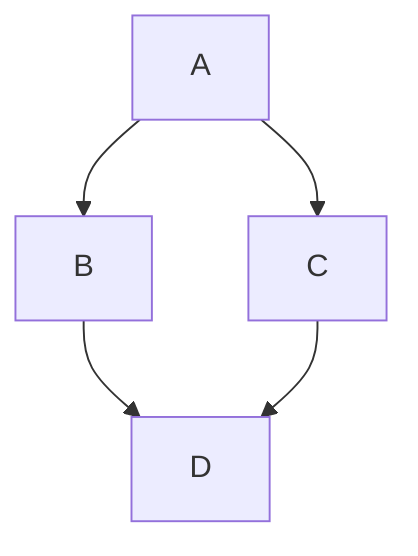

# Daily Learning
## Morning Planning
- [ ] Check out the [github blog](https://github.blog/) for topic ideas.
- [ ] Learn about [GitHub Pages](https://skills.github.com/#first-day-on-github).
- [ ] Convert my first blog post into an actual webpage.
## Review
```C
int add(int a, b)
{
    return a + b;
}
```

## Mermaid block diagram
